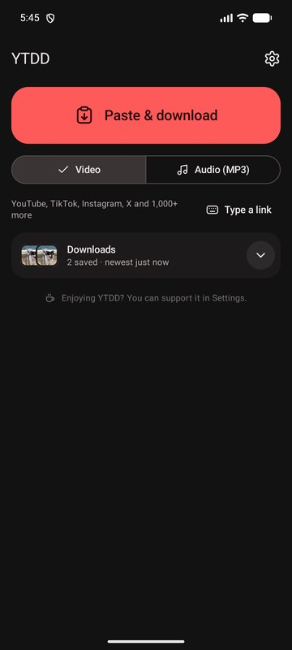
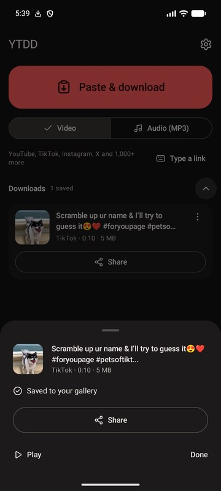
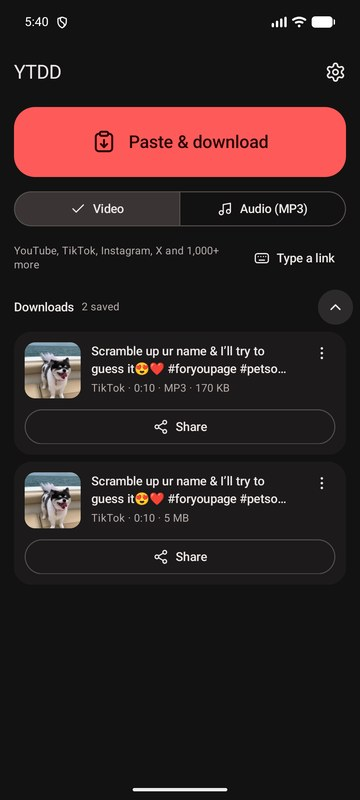
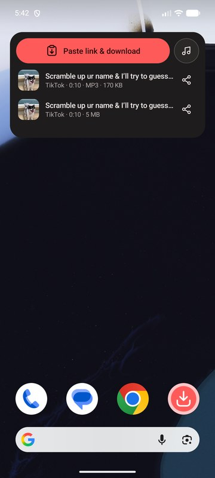

# YTDD for Android
### YT-DLP Downloader

Save videos from YouTube, TikTok, Instagram, X and over a thousand other sites, straight to your phone's gallery. Every video comes out as an MP4 that plays everywhere — ready to post to WhatsApp Status or send in any chat.

## Download

Grab it from the [Releases page](https://github.com/rojea896/YTDD/releases) — look for the newest release named **YTDD for Android** (the Windows version is released on the same page):

- **YTDD-Android-1.0.0.apk** — for almost every phone (recommended)
- **YTDD-Android-1.0.0-universal.apk** — bigger, but runs on any phone. Use it only if the first one says "App not installed"

Needs Android 10 or newer.

## Installing

1. Open the APK on your phone (from Downloads, Drive, or a WhatsApp chat — send it as a *Document*).
2. Android asks you to allow installs from that app. Allow it, then tap **Install**.
3. Google Play Protect may warn that the app is from an unknown developer — tap **Install anyway**. YTDD isn't on the Play Store because Google doesn't allow video downloaders there.

The first launch takes a few seconds while YTDD sets itself up.

## Using it

- **From any app:** tap **Share**, then **YTDD**. A small panel slides up and the download starts straight away. You can hide it and keep scrolling — a notification tells you when it's ready.
- **Copied a link?** Open YTDD and tap **Paste & download**.
- **Video or MP3:** switch between them on the home screen, or tap **Just the audio** while it downloads.
- **Send it:** every download has **WhatsApp** and **Share** buttons. WhatsApp opens its own picker, with **My status** at the top.
- **Even faster:** add the home-screen widget, the Quick Settings tile, or long-press the YTDD icon for "Download link" and "Get MP3" (all in **Settings → Shortcuts**).

Videos are saved to **Movies/YTDD** and MP3s to **Music/YTDD**, so they show up in your gallery and in every app's attach button.

## Good to know

- YTDD keeps its download engine (yt-dlp) up to date by itself, so when a site changes something, downloads usually start working again within a day — no app update needed.
- Videos are H.264 with AAC sound in an MP4. If a site only offers another format, YTDD converts it on your phone.
- Private posts, and sites that only show videos to logged-in accounts (some Instagram and Reddit posts, for example), can't be downloaded.

## On a PC?

There's a Windows version too — see the [main YTDD page](https://github.com/rojea896/YTDD).

## Changelog

See [CHANGELOG.md](CHANGELOG.md).

## License

GPL-3.0 (see `LICENSE`). Built on [yt-dlp](https://github.com/yt-dlp/yt-dlp), [youtubedl-android](https://github.com/yausername/youtubedl-android) and [FFmpeg](https://ffmpeg.org).
